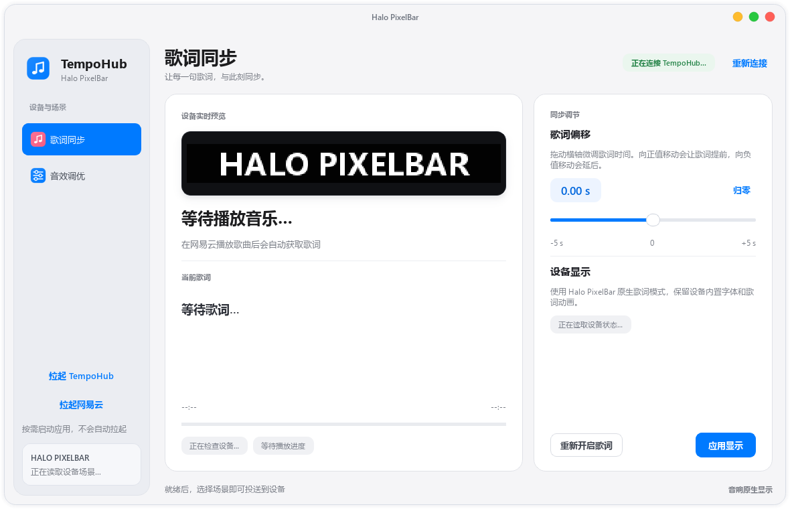

<div align="center">
  <h1>TempoHub 网易云歌词</h1>
  <p><strong>让 花再Halo PixelBar 显示网易云音乐的当前歌词，不改动官方客户端。</strong></p>
  <p>独立补丁副本 · 手动启动 · 两个页面</p>
  <p>
    <a href="#安装"></a>
    <a href="#构建与验证"></a>
    <a href="https://github.com/hcycyxx/TempoHub-2026"></a>
    <a href="LICENSE"></a>
  </p>
</div>

当前控制台只保留**歌词同步**和**音效调优**两个页面：前者负责网易云歌曲匹配、歌词偏移与设备歌词显示，后者切换硬件 Music / Game / Movie 预设。消息通知、游戏性能、自定义频谱预览和原生频谱律动已移除，相关导航、设置和设备指令也已删除。

这是 Windows 桌面补丁，适用于已安装官方 EDIFIER TempoHub、且官方程序内为 Python 3.9 的版本。安装器在本机读取官方 EXE 并生成一份独立副本，官方安装目录不受影响；TempoHub 原有的 QQ 音乐歌词逻辑继续保留。

## 快速开始

```powershell
python installer.py
```

从源码运行安装器需要本机 Python 3.10+ 和已安装的官方 EDIFIER TempoHub；装好后控制台用的是官方自带的 Python 3.9，不用另装。安装后打开桌面快捷方式 **EDIFIER TempoHub - 歌词显示设置**；它只打开控制台，TempoHub 和网易云由控制台左侧的按钮分别拉起。其他安装方式见[安装](#安装)。

## 效果预览

### 控制台

[](docs/images/console-lyrics.png)

上方截图是本地控制台刚打开、尚未连接设备的状态：歌曲、歌词和进度均为占位内容，黑底画面是 256 × 32 设备点阵的模拟预览。截图以 1180 像素宽采集，点击图片可查看原尺寸。

| 页面 | 内容 |
| --- | --- |
| **歌词同步** | 网易云当前歌曲匹配、播放进度、歌词偏移（-5 s ~ +5 s）、Halo PixelBar 原生歌词显示、重新开启歌词与应用显示。 |
| **音效调优** | 硬件 Music / Game / Movie 预设切换、调音方向曲线、各模式的适用建议、返回歌词显示。 |

音效页的曲线仅用于解释调音方向，不代表设备实测频响；点阵预览是控制台内的模拟视图，不是设备实拍。

## 功能

- **歌词同步**：读取网易云当前歌曲与进度，匹配并显示歌词；歌词偏移正值提前、负值延后，调整后自动保存。设备仍使用 Halo PixelBar 原生歌词模式，沿用设备内置字体和歌词动画。
- **音效调优**：直接切换 Halo PixelBar 的硬件 DSP 预设（音乐 / 游戏 / 电影），只发送预设索引，不新增自定义曲线。
- **手动启动**：两个桌面快捷方式都只打开控制台。左侧 **拉起 TempoHub** 和 **拉起网易云** 互不联动，控制台与 Hub 后台都不会自动启动或重启网易云；已正常运行的应用继续使用。
- **保留原生交互**：一体化圆角窗口、红黄绿窗口按钮、拖动、缩放和关闭前保存均保留。QQ 音乐歌词回退逻辑不做修改。
- **边界清晰**：无法实时同步的消息通知、游戏性能、自定义频谱预览和原生频谱律动已完整移除，不保留占位页或隐藏设置。

**拉起网易云** 会以 `--remote-debugging-port=9222` 启动客户端，供补丁读取精确播放进度。若网易云已在运行，该按钮只把已有窗口带到前台，不会中断或重启播放；此时精确进度取决于该实例是否由本按钮启动。

## 安装

### 从源码

1. 确认已安装官方 EDIFIER TempoHub，且安装目录含 `_internal\python39.dll`。
2. 在本仓库根目录运行：

```powershell
python installer.py
```

安装前会结束正在运行的 TempoHub 进程，随后在 `%LOCALAPPDATA%\TempoHubNetEase` 生成补丁副本，并创建两个桌面快捷方式。可用 `--app-dir` 指定官方安装目录、`--output-dir` 指定输出位置、`--no-shortcuts` 跳过快捷方式。

### 已构建安装包

`TempoHub-NetEase-Installer.exe` 由[构建脚本](#构建与验证)生成，自带 Python 3.9 运行库，无需另装 Python，但仍需先安装官方 EDIFIER TempoHub。已发布的 v1.0.8 安装包见 [Release 页面](https://github.com/blankhcy-dot/TempoHub-2026/releases/latest)；该 Release 托管在项目的另一仓库，本仓库当前只包含源码与构建流程。

### 卸载

在补丁目录内运行 `uninstall.ps1`。脚本只删除带 `.tempo-nexe-install` 标记的补丁目录和对应快捷方式，官方 TempoHub 不受影响。

## 使用

默认安装到 `%LOCALAPPDATA%\TempoHubNetEase`，相关位置如下：

| 项目 | 位置 / 默认值 |
| --- | --- |
| 桌面快捷方式 | **EDIFIER TempoHub - 歌词显示设置**、**EDIFIER TempoHub - 网易云歌词** |
| 设置文件 | `%APPDATA%\TempoHubLyrics\settings.json` |
| 运行日志 | `%TEMP%\tempo_hub_netease_lyrics.log` |
| 歌词偏移 | `0.00 s`，范围 -5 s ~ +5 s |
| 启动方式 | 控制台手动拉起，不自动启动应用 |

本地更新后重新打开控制台，以载入新的页面代码。右上角按钮从左到右为最小化、最大化、关闭。

## 构建与验证

修改 `src/app/utils/` 下的运行源码后，必须用 Python 3.9 重新编译 payload，否则改动不会进入安装包：

```powershell
./runtime39/python.exe scripts/compile_payload.py
```

构建安装包需要本机 Python 与 PyInstaller（[构建工作流](.github/workflows/build.yml)用 3.10 + PyInstaller 6.22.3）：

```powershell
./build_release.ps1 -Python python
```

回归测试使用 Python 3.9 与官方 TempoHub 自带的 Qt 运行库：

```powershell
./runtime39/python.exe tests/run_tests.py --qt-app "C:/Program Files (x86)/EDIFIER TempoHub"
```

[构建工作流](.github/workflows/build.yml)只在手动触发或推送 `v*` 版本标签时打包，不自动运行测试。安装器启动检查与包内容校验见 `tests/verify_packaged_patch.py`；提交问题时请提供 Windows 版本、官方 TempoHub 版本与设备型号，避免附带个人设置文件。

## 兼容性与数据

仅支持 Windows，且依赖官方 EDIFIER TempoHub 的 Python 3.9 运行库：安装器会检查 `_internal\python39.dll`，缺失时直接报错。其他官方版本、macOS 与 Linux 均未验证。

安装器读取本机已安装的官方 EXE，用目录连接（junction）复用官方 `_internal` 资源，并复制官方自带的 PyQt6；仓库不分发官方程序或官方资源。歌词通过网易云公开接口查询；构建或安装时可能下载 Python 3.9 嵌入式运行库。设置与日志只写在上面列出的本机路径，控制台不改动官方安装目录。

补丁依赖用户已有的官方授权安装。若自行打包分发，请复核所含组件的许可，尤其是 PyQt6，见 [第三方声明](THIRD_PARTY_NOTICES.md)。

## 文档

| 文档 | 内容 |
| --- | --- |
| [第三方声明](THIRD_PARTY_NOTICES.md) | Python、PyQt6、PyInstaller、SoundCard 等组件来源与许可 |
| [安装与构建脚本](build_release.ps1) | 安装包构建流程 |
| [安装器源码](installer.py) | 官方程序定位、补丁副本与快捷方式生成 |

## 许可与致谢

MIT，见 [LICENSE](LICENSE)。本项目与 EDIFIER、花再和网易云音乐无关联；补丁使用独立目录，不修改也不分发官方程序。
